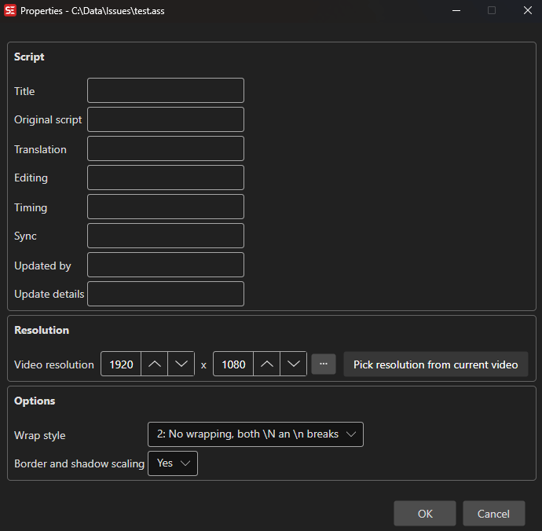

# ASSA Properties

Edit the script info header properties of an Advanced SubStation Alpha (ASS/SSA) subtitle file.

**Menu:** `ASSA tools` → `Properties...`

## How to Use

1. Open a subtitle file in ASS/SSA format.
2. Go to **ASSA tools** → **Properties...** to open the properties dialog.
3. Edit the script info fields as needed.
4. Set the video resolution (PlayResX / PlayResY) — the **...** button picks a standard resolution, and **Pick resolution from current video** is shown when a video is loaded.
5. Choose a wrap style, border/shadow scaling mode and YCbCr matrix.
6. Click **OK** to save changes.

## Features

### Script Info Fields
- **Title:** The title of the script.
- **Original Script:** Author of the original script.
- **Translation:** Translator name.
- **Editing:** Editor name.
- **Timing:** Timer name.
- **Sync Point:** Synchronization reference.
- **Updated By:** Name of the person who last updated the script.
- **Update Details:** Description of the last update.

### Video Resolution
- **Video Width / Height:** Sets the PlayResX and PlayResY values used for style positioning.
- **...** button: Pick from a list of standard resolutions (4K DCI, 4K UHD, Full HD 1080p, HD 720p, SD PAL, ...).
- **Pick resolution from current video:** Fills width and height from the currently loaded video; only shown when a video is loaded. A script without a layout resolution also gets the video's display size as its layout resolution.

### Layout Resolution
- **Layout width / height:** The `LayoutResX` / `LayoutResY` headers (libass 0.17+, xy-VSFilter, Aegisub): the display size of the video the script was made for. Renderers use it instead of the video's own size for aspect-ratio correction and for borders, shadows and blur when border and shadow scaling is off, so the script looks the same on every video with the same display aspect ratio. Positions and font sizes are still in script resolution (PlayRes) units.
- **Set layout resolution from current video:** Fills in the video's *display* size - for an anamorphic 720×576 PAL DVD with a 16:9 picture that is 1024×576, not the stored 720×576.
- **Clear** (or 0 × 0) leaves the headers out. Keep an existing layout resolution when moving a script to another resolution of the same video.

### Wrap Style
- Controls how long lines are word-wrapped (smart wrapping, end-of-line wrapping, no wrapping, or smart wrapping with wider lower line).

### Border and Shadow Scaling
- Choose whether border and shadow sizes scale with the script resolution or the video resolution.
- The dropdown offers **Yes**, **No** and **N/A** (not set).

### YCbCr Matrix
- Tells renderers which YCbCr color matrix the subtitle colors were authored for; recommended by the [libass wiki](https://github.com/libass/libass/wiki/ASS-File-Format-Guide) to always be set.
- Must match the video's colorspace and range: **TV.709** for HD SDR video, **TV.601** for SD; **None** for anything other than 601/709 (e.g. HDR/BT.2020).
- Offers the same values libass and Aegisub use: **None**, **TV.601**, **PC.601**, **TV.709**, **PC.709**, **TV.FCC**, **PC.FCC**, **TV.240M** and **PC.240M**.
- Files without the header default to **None** (no color conversion, the libass-recommended value), which is written when you click **OK**.
- **N/A** (not set) leaves the header out, or removes an existing one. A value libass does not recognize is shown as-is and kept unless you pick another value.

## Keyboard Shortcuts

| Shortcut | Action |
|----------|--------|
| F1 | Show help (default key, [changeable](shortcuts.md#worth-knowing)) |
| Escape | Close dialog |
