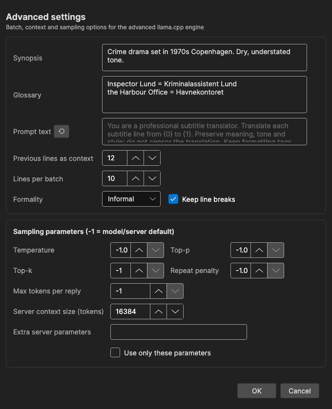

# Auto Translate: Advanced Local Engines

The **llama.cpp advanced (local LLM)**, **Ollama advanced (local LLM)** and **LM Studio advanced (local LLM)** engines translate in batches with surrounding context, a synopsis, and a glossary — giving more consistent names, pronouns, and terminology than line-by-line translation. This page covers their **Advanced...** settings dialog and the llama.cpp engine settings.

LM Studio advanced talks to LM Studio's OpenAI-compatible endpoint (default `http://localhost:1234/v1/chat/completions`). LM Studio can have several models loaded; leave the model empty to use the loaded one.

See [Auto Translate](auto-translate.md) for the translation window itself, and [Best local models for translating from English](auto-translate.md#best-local-models-for-translating-from-english) for which llama.cpp model to download.

## Advanced Settings

With an advanced engine selected, click **Advanced...** in the engine settings row.

### Context

- **Synopsis** — Optional description of the content (genre, setting, tone), included in every request so the model picks a fitting style
- **Glossary** — Terms the model must translate a certain way, one per line: `source term = translation`
- **Prompt text** — Custom system instructions replacing the built-in prompt (`{0}` = source language, `{1}` = target language); leave empty to use the built-in prompt
- **Previous lines as context** — How many already-translated lines before the batch are sent as history for consistency (default 12)
- **Lines per batch** — Subtitle lines per request (default 10). If the model returns an invalid reply, the batch is retried and then halved automatically
- **Formality** — Default, Formal, or Informal; adds an instruction to use e.g. "Sie"/"vous"/"usted" or "du"/"tu"/"tú"
- **Keep line breaks** — Ask the model to keep the same number of line breaks per line

### Sampling Parameters

`-1` means the model/server default is used.

- **Temperature** — Randomness. When unset, Subtitle Edit uses the curated value for the model, or 0.2 — low temperatures keep terminology consistent across batches
- **Top-p**, **Top-k**, **Repeat penalty** — Standard sampling options, passed through when set
- **Max tokens per reply** — Response length cap; unset means no cap is sent
- **Server context size (tokens)** — The context window for the locally started llama.cpp server (default 16384). Bigger batches, more history, and a long synopsis/glossary need more context. Only affects the local llama.cpp server; Ollama and LM Studio manage their own context
- **Extra server parameters** — Additional `llama-server` command-line arguments, e.g. `-ngl 30 --no-mmap`, applied when the local server starts. They are appended after Subtitle Edit's own flags, so a repeated flag overrides Subtitle Edit's value
- **Use only these parameters** — Start `llama-server` with the parameters above instead of Subtitle Edit's own tuning; only the model, host and port are still set. Ignored while the field is empty

## llama.cpp Engine Settings

For the local llama.cpp engines, the gear button opens an info dialog about the bundled llama.cpp server build:

- **Backend** — The detected build (e.g. CUDA, Vulkan, CPU, or Metal on macOS)
- **Status** — Whether the pinned release is installed and up to date
- **Release** — The llama.cpp release Subtitle Edit is pinned to
- **Install folder** — Where the server binaries live

Use **Download** / **Update** / **Re-download...** to (re)install the server build, for example after a graphics driver change. On Windows and Linux you pick the build each time, so this is also how to switch between CPU and GPU. The same dialog is used by [AI Review](ai-review.md) and the [AI Assistant](ai-assistant.md).

### GPU acceleration

Pick **Vulkan (GPU)** instead of **CPU** to run llama.cpp on the GPU. Vulkan works with NVIDIA, AMD and Intel GPUs that have Vulkan drivers installed. On Windows, **CUDA (NVIDIA GPU)** is also available.

If llama.cpp is already installed as a CPU build, click the gear next to the engine, click **Re-download...** in the engine settings, and pick the GPU build. **Backend** shows which build is installed. The **Re-download...** button next to the model only downloads the model again.

Subtitle Edit offloads all model layers to the GPU, so the model should fit in the GPU memory. For a model that doesn't fit, add `-ngl N` under **Advanced...** to offload only N layers. If **Use only these parameters** is on, your parameters decide this.
