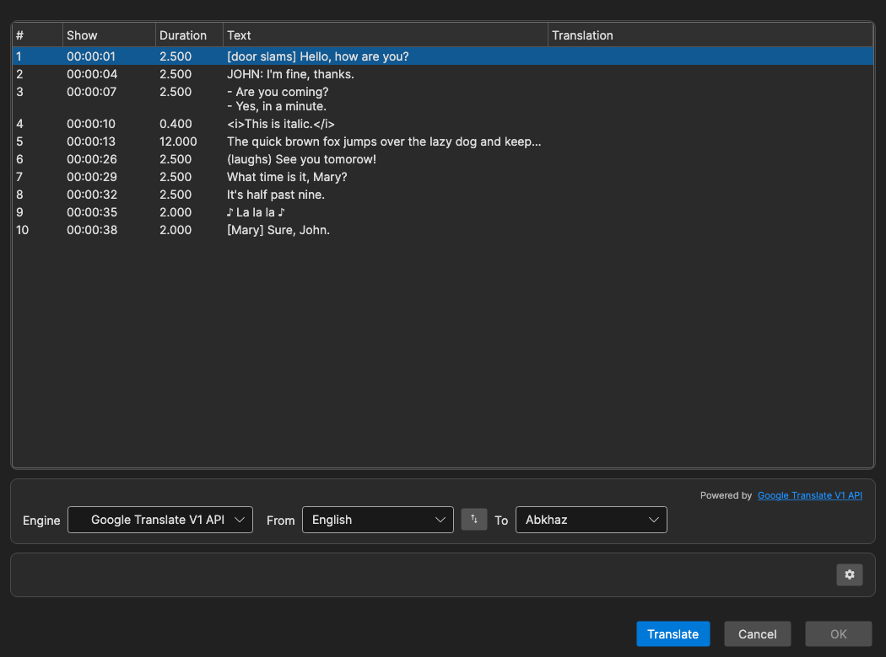

# Auto Translate

Automatically translate subtitles using various translation engines and AI services.

- **Menu:** Translate → Auto-translate...
- **Shortcut:** Configurable

<!-- Screenshot: Auto translate window -->


## How to Use

1. Open **Translate → Auto-translate...**
2. Select a translation engine
3. Select the source and target languages (the button between them swaps the two)
4. Click **Translate** to start
5. Review the translations in the grid
6. Click **OK** to apply

### Translating selected lines

Right-click selected lines in the grid and choose **Auto-translate** to translate only those lines. With no original column open, the dialog offers **Translate in place (do not create original)**: the translated text replaces the selected lines' text instead of turning the subtitle into the original. Otherwise the whole subtitle becomes the original, as with a whole-file translation.

The shortcut **Auto-translate selected lines (no prompt, use last engine/languages)** (no default key; set it in [Shortcuts](shortcuts.md)) starts right away with the last used engine and languages; the dialog only shows progress and closes when done. Until a translation has been run once, it prompts as usual.

## Supported Engines

- **Google Translate V1 API** — Free Google Translate. When Google answers with its "unusual traffic" block page, Subtitle Edit retries the request through a fallback endpoint (`clients5.google.com`) before giving up; a block is on Google's side and is usually lifted again after minutes to a few hours
- **Google Translate V2 API** — Google Cloud Translation (requires API key)
- **Bing Microsoft Translator** — Azure Cognitive Services (requires API key). For a regional or multi-service Azure resource, also enter its **Region**, for example `westeurope` (shown under Keys and Endpoint in the Azure portal); leave it empty for a global resource
- **DeepL V2 translate** — DeepL translation (requires API key). Every language the DeepL API offers is listed, as source and as target (including the target-only regional variants such as fr-CA and de-CH). A **Formality** dropdown — Default, More formal, Less formal, More formal (fall back to default), Less formal (fall back to default) — appears for target languages that support it
- **LibreTranslate** — Open-source, self-hosted translation
- **MyMemory Translate** — Free translation memory
- **ChatGPT** — OpenAI AI translation (requires API key)
- **LM Studio (local LLM)** — Local LLM translation
- **LM Studio advanced (local LLM)** — LM Studio translated in batches with surrounding context, a synopsis and a glossary; see [Advanced local engines](auto-translate-advanced.md)
- **Ollama (local LLM)** — Local LLM-based translation
- **Ollama advanced (local LLM)** — Ollama translated in batches with surrounding context, a synopsis and a glossary; see [Advanced local engines](auto-translate-advanced.md)
- **llama.cpp (local LLM)** — Server-managed local LLM translation; Subtitle Edit downloads llama.cpp and a curated model (Index-Translate, TranslateGemma, Gemma 4, Qwen, Aya Expanse, MiLMMT, Hy-MT2 or TranslatePsy-AfriSLM for English ↔ 19 African languages) and runs a local `llama-server` for you. See [Best local models for translating from English](#best-local-models-for-translating-from-english) for a recommendation and [Using your own model](#llamacpp-using-your-own-model) to run a model we don't ship, such as TranslateGemma 27B
- **llama.cpp advanced (local LLM)** — The managed llama.cpp server translated in batches with surrounding context, a synopsis and a glossary; see [Advanced local engines](auto-translate-advanced.md)
- **OpenAI Compatible API** — Generic engine for any service exposing an OpenAI-compatible `chat/completions` endpoint (vLLM, KoboldCpp, a llama.cpp server on another machine, cloud providers, ...); configure URL, model, prompt, and an optional API key
- **Anthropic Claude** — AI translation (requires API key)
- **Groq** — AI translation (requires API key)
- **OpenRouter** — AI translation (requires API key)
- **API Route** — AI translation through [api-route.com](https://www.api-route.com) (requires API key)
- **Lara** — AI translation (requires API key)
- **Perplexity** — AI translation (requires API key)
- **Google Gemini** — AI translation (requires API key)
- **NVIDIA** — AI translation (requires API key)
- **Mistral AI Translate** — AI translation (requires API key)
- **DeepSeek** — AI translation (requires API key)
- **Papago Translate** — Naver Papago translation (requires API key)
- **thammegowda-nllb-serve** — Self-hosted NLLB (No Language Left Behind) server
- **winstxnhdw-nllb-api** — NLLB (No Language Left Behind) API
- **Baidu Translate** — Baidu translation (requires App ID and secret)
- **CrispASR MADLAD** — Local MADLAD-based translation with downloadable models (shown with size and install status); also available in Batch Convert. The language list is the 419 languages the MADLAD-400 model itself knows, so it is both longer and shorter than the usual one: it adds languages such as Iloko, Waray, Papiamento, Moroccan Arabic and Latin, and leaves out ones MADLAD cannot produce — including Cantonese, for which Google Translate, NLLB or any of the LLM engines are the alternatives. Quality varies a lot across that long tail — Google evaluated only about half of the languages the model claims

## CrispASR MADLAD: CPU and GPU builds

When CrispASR is downloaded you choose a build: **CPU**, **Vulkan** or **CUDA** on Windows, plus **ROCm** on Linux x64. macOS and Linux ARM64 have one build, so there is nothing to choose. MADLAD stays on the CPU on macOS.

- **CPU** — no GPU needed and the smallest download. Windows also has a Legacy build for CPUs without AVX2.
- **Vulkan** — AMD, NVIDIA and Intel GPUs, including integrated graphics, with a working Vulkan driver.
- **CUDA** — NVIDIA GPUs. Pick CUDA 12 or CUDA 13 to match your driver.
- **ROCm** — supported AMD GPUs on Linux. Not every AMD GPU supports it.

To switch later, click the gear next to the **CrispASR MADLAD** model, in Auto Translate or Batch Convert, and then **Re-download** or **Update**. Downloaded models are kept. The **Update** button next to the engine keeps your current build.

Speech-to-text shares the CrispASR engine, so a build you pick here is used there too, and a GPU build you installed for speech-to-text already runs MADLAD on the GPU.

A GPU build uses the GPU automatically. The model is a 2.04 GB download and needs more than that in VRAM once it is running. If a line fails on the GPU, for example because the model does not fit, Subtitle Edit retries it on the CPU and stays on the CPU for the rest of that translation, so it finishes more slowly rather than failing. To see whether the GPU is doing the work, watch its activity while translating.

A GPU build is not always faster here: each subtitle line starts CrispASR and loads the model again, and that time is the same however fast the GPU is.

## Best local models for translating from English

To translate English subtitles into Spanish, German, Danish or another language on your own machine, start with **Index-Translate 9B (Q4_K_M)** in the **llama.cpp** engine. All the models below are in its download list.

| Model | Download | Why pick it |
|-------|----------|-------------|
| **Index-Translate 9B (Q4_K_M)** | 5.8 GB | Best overall, with the fewest meaning errors in every language we tested. About 1.3 s per line on an M4 Mac |
| **Index-Translate 2B (Q8_0)** | 2.1 GB | Best small model, for limited memory or when speed matters most. About 0.6 s per line, with more slips than the 9B |
| **Gemma 4 E4B it (Q4_K_M)** | 5.4 GB | Good alternative at about 1 s per line, with more errors than the 9B in Danish and German but not in Japanese |
| **TranslateGemma 12B (Q4_K_M)** | 7.3 GB | Close to the 9B in quality, but it can return English lines untranslated when lines are merged into one request. Subtitle Edit detects this and retries, so it can take longer |
| **TranslatePsy-AfriSLM 4B** | 3.1 GB | The one to use for the 19 African languages it covers |

These recommendations come from small tests of about 24 lines of English dialogue, mostly into Danish, German and Japanese, with Index-Translate 9B also tested into Spanish, French, Russian and Chinese. Results for other languages can differ, so try a few lines before translating a whole file.

**CrispASR MADLAD** made more meaning errors than Index-Translate 9B in the same tests (5 against 1 of 24 lines into German). Its strength is its long language list.

A bigger download is not automatically better. Qwen 3.8 27B at 2-bit (9.8 GB) was about four times slower than Index-Translate 9B and clearly worse, because the heavy compression damages the output. Bonsai 27B is listed for [AI Review](ai-review.md) as English only, and is not a translation model.

For a whole episode or film, use **llama.cpp advanced** so that names and terms stay consistent, see [Advanced local engines](auto-translate-advanced.md).

## llama.cpp: using your own model

The models offered in the download list are deliberately kept small enough to run on an ordinary
machine (mostly under 8 GB, the largest around 12 GB). You are not limited to them — larger models such as TranslateGemma
27B work fine if your hardware can handle them.

Two ways to use one:

1. **Drop a `.gguf` into the models folder.** Copy the file into Subtitle Edit's `llama.cpp/models`
   folder and it appears in the model list marked *(custom)*. Subtitle Edit recognizes the model
   family from the file name and starts `llama-server` with the right chat template, so a
   self-downloaded TranslateGemma or Qwen quant behaves like the curated ones.
2. **Run your own server.** Tick **Use remote server** and point Subtitle Edit at any
   `llama-server` you started yourself (the default is `http://localhost:8080/v1/chat/completions`).
   Subtitle Edit then does no model management at all.

Be aware of what a bigger model costs. TranslateGemma 27B at Q4_K_M is roughly a 16 GB download and
needs about 20 GB of VRAM to run fully on the GPU — a 24 GB card in practice. Google's own figures
put the 12B ahead of the Gemma 3 27B baseline, so the 12B in the download list is already a strong
choice and the jump to 27B buys less than the size difference suggests.

## Prompts: chat models and completion models

Every local-LLM engine (LM Studio, Ollama, llama.cpp, OpenAI Compatible API) has a
**prompt** you can edit in the engine's Settings dialog (gear button). `{0}` is replaced with the source language and `{1}` with the target
language, both as English names.

By default the prompt is an instruction and Subtitle Edit appends the subtitle text after it — what
a chat-tuned model expects.

Some translation models are trained on a *completion* format instead: the text has to sit inside the
prompt, followed by a cue for the target language. Write `{2}` where the text belongs and Subtitle
Edit sends the filled-in template as one block instead of appending anything. For example
[MiLMMT-46](https://huggingface.co/xiaomi-research/MiLMMT-46-12B-v1.0) (Xiaomi's 46-language
translation model) is trained on:

```
Translate this from {0} to {1}:
{0}: {2}
{1}:
```

The trailing `{1}:` cue is what makes such a model translate at all — without it, it tends to echo
the source. Set the model's temperature to 0 where the engine offers it. Curated MiLMMT models in
the llama.cpp engine's download list carry this prompt already; for LM Studio, Ollama or
your own OpenAI-compatible server (vLLM, KoboldCpp, ...), paste it into the engine's prompt field.

Headless runs take the same prompt via `seconv --translate-prompt:<text|file>` — see
[Auto-translate (command line)](../reference/command-line.md#custom-prompt).

## Engine Configuration

Depending on the selected engine, you may need to provide:

- **API Key** — Authentication key for cloud services
- **API URL** — Custom endpoint URL (for self-hosted services)
- **Model** — Specific model to use (for AI engines)

The gear button opens the engine's **Settings** dialog with **Line merge**, **Delay in seconds between requests**, **Max bytes per request** and, for engines that have one, the **Prompt text** with a reset-to-default button. **Do not translate lines in music symbols (♪ ... ♪)** leaves song lines untranslated.

The **llama.cpp advanced**, **Ollama advanced** and **LM Studio advanced** engines translate in batches with context, synopsis, and glossary support — see [Advanced Local Engines](auto-translate-advanced.md).

## Translation Review

The translation grid shows the original text alongside the translated text. You can edit individual translations before accepting them.

Engines keep the source's line breaks and often add their own, so a two-line source can come back as three short lines that no long-line tool would touch. After translating, a row with more lines than the *maximum number of lines* or a line longer than the single-line limit is un-broken and auto-broken again with the target language's rules. Rows that already fit are left alone, and lyrics (♪) and CJK targets are never re-broken.

Switching engine to compare results keeps the source and target languages you picked, as long as the new engine offers them - only then does the default derived from the subtitle take over.

## Keyboard Shortcuts

| Key | Action |
|-----|--------|
| Escape | Close / Cancel |
| F1 | Show help (default key, [changeable](shortcuts.md#worth-knowing)) |
