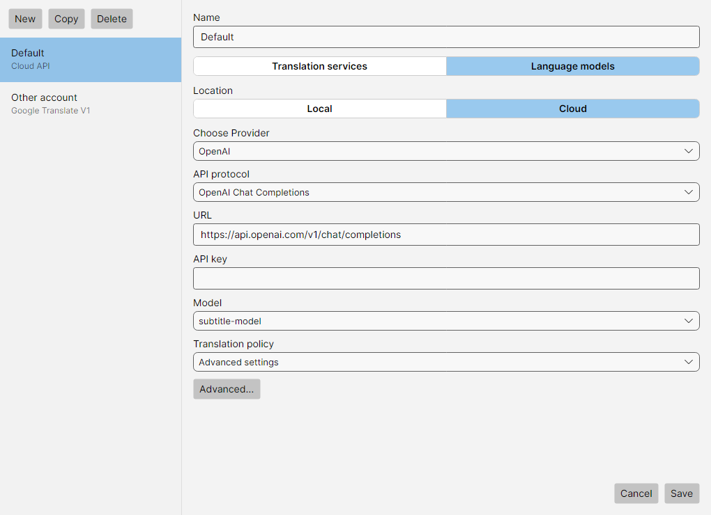
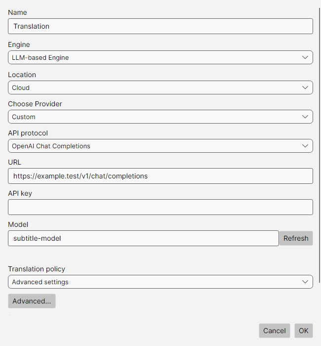

# Auto Translate

Open **Translate → Auto-translate...**, choose a named **Profile**, select the source and target languages, and click **Translate**. Review the results in the grid, then click **OK** to apply them.

## Named profiles

The initial profile is named **Default**. New profiles start with **Default**, **Default (2)**, and so on until you give them your own name. The profile selector is shared by Auto Translate and Batch Convert. Each window remembers its own selected profile.

Click **…** beside the Profile dropdown to open **Manage profiles**. The list shows each profile's name and engine in its saved order. Selecting a row edits it on the right; this does not change the profile used for translation.

- **New** and **Copy** append an independent profile and select it for editing. Copy includes the connection, API key, and Advanced policy.
- Edit **Name** to rename a profile. Names must be non-empty and unique, ignoring case and surrounding spaces.
- Use Ctrl/Shift to select several profiles, or Ctrl+A to select all, then **Delete**. With several rows selected, the editor shows the selection count.

Edits stay in drafts while switching rows. **Save** applies the whole session at once; **Cancel**, Esc, or closing the window discards it. Validation selects the profile needing correction. Unchanged legacy connections do not block saving other changes, and a failed write keeps the drafts available for retry.

After saving, both open profile selectors refresh and keep their selected profile by ID. Deleting a profile in use clears that selector without choosing a replacement. You can delete every profile and create another through **…**. Running translations use a snapshot of their connection and policy.

## Engine

The editor starts with a horizontal **Translation services / Language models** switch. The selected segment is highlighted; click either side or use the left/right arrow keys to switch. **Translation services** shows a dedicated Engine list. **Language models** shows a second **Local / Cloud** switch: Local offers llama.cpp, Ollama, LM Studio, and **Local API**, while Cloud offers provider presets.

Services include Google Translate V1/V2, Microsoft Translator, DeepL, LibreTranslate, MyMemory, Lara, Papago, Baidu, NLLB API/Serve, and CrispASR MADLAD. For example, DeepL profiles save their API key, API URL, and formality independently. LibreTranslate and MyMemory allow an empty API key. CrispASR MADLAD profiles can use executable/model files directly or the existing model download controls.

## API connections

For hosted models, choose **Language models → Cloud**, then choose a provider preset or **Custom**. For a local service, choose **Language models → Local**, then choose an inference engine. Switching between these choices preserves each engine's draft URL.

A provider preset fills **API URL** and offers model suggestions in an editable **Model** dropdown. Select **OpenAI Chat Completions** or **Anthropic Messages** separately, then enter the API key. You can edit the URL to use a compatible proxy or any other compatible service.

Model lists reload automatically when you open a profile, change providers or connection settings, or open the Model dropdown. Built-in provider suggestions remain available while loading or when the service cannot return a model list. URL and API key edits are applied when you leave the field. You can always type a model name manually, including when a proxy does not expose a model-list route. Changing providers preserves an already-entered model and API key. LM Studio and a managed llama.cpp server can use their loaded model without a model identifier.

All LLM profiles default to **Advanced** translation. The profile editor's **Advanced...** button configures batches, context, synopsis, glossary, prompts, and sampling. See [Advanced translation](auto-translate-advanced.md).

Choose **Translate each line separately** explicitly to use the independent single-line prompt instead. Advanced translation never automatically switches to this mode after an error.

### Local llama.cpp

Subtitle Edit retains its model download, install status, server start/stop, and engine settings controls. Select a chat-compatible model from the list, or place a custom `.gguf` in the llama.cpp models folder.

To connect to a server you manage yourself, enable **Use remote server** in the profile editor and enter its API endpoint. In this mode Subtitle Edit does not download a model or start a server.

The new desktop profiles use chat APIs for both Advanced and single-line translation. Completion-only models such as MiLMMT require a replacement chat-compatible model. The command-line interface retains its existing options and behavior; see [command-line translation](../reference/command-line.md).

## Existing settings and imports

Configured engines are migrated once into named profiles using their original engine display names (for example, **Google Translate V1 API**, **DeepL V2 translate**, or **OpenRouter**). Name collisions receive numeric suffixes. **Default** is reserved for a fresh initial profile and manually created profiles; existing profile names are preserved on later loads. Different classic and advanced configurations remain separate. Existing LLM profiles also default to Advanced after migration; their old prompt is retained for manual single-line mode. URLs that cannot be safely converted from a completion route are preserved and marked for review.

Gemini profiles use its OpenAI-compatible endpoint. Mistral and OpenRouter keys are copied from the effective shared provider settings into the translation profile; subsequent translation edits do not change OCR or speech credentials. JSON and SE4 XML settings imports also create profiles from legacy translation settings.

## Selected lines and review

Right-click selected subtitle lines and choose **Auto-translate** to translate those lines. With no original column open, **Translate in place (do not create original)** replaces their text directly. The no-prompt shortcut uses the last selected profile and languages.

The grid shows source and translated text side by side and allows editing before acceptance. Source and target language choices are carried across profiles when supported by the new engine.

The main Settings button controls request delay, maximum request size, and whether music lines (`♪ ... ♪`) remain untranslated. Traditional profiles can also choose their line-merge strategy there. LLM translation mode and prompts belong to the profile editor.

| Key | Action |
|-----|--------|
| Escape | Close / Cancel |
| F1 | Show help |
