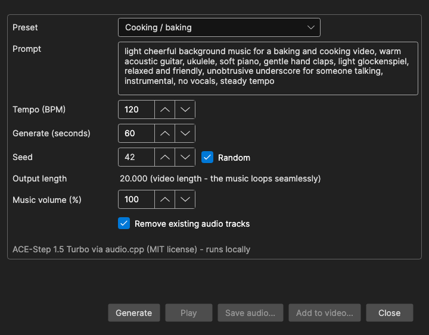

# Generate Background Music

Generate royalty-free instrumental background music from a text prompt, loop it seamlessly to the length of the video, and put it on the video - or mix it under the speech made by [Text to Speech](text-to-speech.md).

- **Menu:** Video → More → Generate background music...
- **Shortcut:** None (menu only)

The music is made on your own computer by **ACE-Step 1.5 Turbo** (MIT license) running on the audio.cpp runtime - nothing is sent to an online service. The **More** submenu is shown while a video is loaded, and ffmpeg is required (you are offered to download it when it is missing).

## How to Use

1. Open **Video → More → Generate background music...**
2. Pick a **Preset**, or choose *Custom* and write your own **Prompt**.
3. Click **Generate**. The first time, the runtime and the model are downloaded (see [Requirements](#requirements)). The progress bar shows the current step - loading the model, composing, generating audio, decoding audio, creating a seamless loop - and the estimated time left.
4. Click **Play** to listen (click **Stop** to stop). Not happy? Click **Generate** again - with **Random** seed checked, every run gives a different piece.
5. Click **Add to video...** to write a copy of the video with the music, or **Save audio...** to save the music as a `.wav` file.

The window is not modal, so the main window stays usable while it is open; only one background music window can be open at a time. **Cancel** while generating or adding stops the work; otherwise the button reads **Close**.

## Presets

Each preset fills in a prompt and a tempo that were tried to give music without vocals that loops cleanly:

- Cooking / baking (120 BPM)
- Corporate / explainer (100 BPM)
- Forest / nature (84 BPM)
- Lo-fi vlog (85 BPM)
- Relaxing piano (72 BPM)
- Tech / gadget review (110 BPM)
- Custom - keeps the prompt you write

Preset prompts are in English, since they are input for the model. They all end with a phrase that keeps the music unobtrusive and instrumental, for example "unobtrusive underscore for someone talking, instrumental, no vocals, steady tempo". Keep a similar ending in your own prompts. Vocals, singing, choir, rap, distorted guitar, heavy drums and dark or horror moods are always asked to be left out.

## Options

| Option | Description | Default |
|--------|-------------|---------|
| Preset | A starting point for the prompt and tempo; editing the prompt afterwards is kept | Cooking / baking |
| Prompt | Description of the music: genre, instruments, mood | (from the preset) |
| Tempo (BPM) | Beats per minute, 40-200 | 120 |
| Generate (seconds) | How much music the model makes, 20-240. A longer video loops this clip; a short video only needs a little more than its own length, so less is generated | 60 |
| Seed | The random seed. The same prompt, tempo, length and seed give the same music | 42 |
| Random | Pick a new seed for each **Generate** (the seed used is shown in the Seed field, so a piece you like can be made again) | On |
| Output length | Shows the final length - the video's length, as the music loops seamlessly | - |
| Music volume (%) | Level of the music, 0-200 | 100 |
| Remove existing audio tracks | The music replaces all the video's audio | On |
| Original audio volume (%) | Shown when **Remove existing audio tracks** is off: level of the video's own audio, which the music is mixed under | 100 |

All settings are remembered.

## Looping

The model makes a clip of **Generate (seconds)**. Subtitle Edit then finds a loop in it that is aligned to the bars of the measured tempo and repeats it to the full length, with a fade-out at the end, and normalizes the level. After generating, the result line shows the loop's length, the measured tempo and how well the seam matches ("Loop: ... at 120 BPM, seam match 94%"), or "Music ready: ..." with the length when no loop is needed.

## Add to Video

**Add to video...** asks for the output file (by default the video name with `_music` added, in the same format) and runs ffmpeg:

- The video stream is copied, not re-encoded, so it is quick and lossless.
- With **Remove existing audio tracks**, the music becomes the only audio track.
- Without it, the video's first audio track is kept at **Original audio volume** and the music is mixed under it.
- The audio is encoded as AAC (192 kb/s), or Opus for a `.webm` output.
- The output file cannot be the input video.

When done, a file-saved prompt offers to open the containing folder or play the video.

## With Text to Speech

In the [Text to Speech](text-to-speech.md) window, check **Add background music** to mix generated music under the dubbed speech. The settings button next to it opens this window in a text to speech mode:

- **Add to video...**, **Remove existing audio tracks** and **Original audio volume** are hidden, and an **OK** button is shown instead.
- **Music volume** is the level between lines (30% by default, saved separately). The music dips automatically while someone talks and comes back up in the gaps.
- The output length follows the generated speech.
- Music you generate here is reused by the text to speech run when the prompt, tempo and length are unchanged, so the piece you listened to is the one you get. **OK** checks **Add background music**.

## Requirements

- **audio.cpp runtime** - shared with the audio.cpp text to speech engines (IndexTTS 2.5, Higgs Audio v3, Fish Audio S2 Pro, ...). If it is missing, or too old to have ACE-Step, you are asked to download it. On Windows and Linux you pick the CPU, Vulkan or CUDA build; a GPU build is much faster. On macOS it needs an Apple Silicon Mac and uses Metal.
- **ACE-Step 1.5 Turbo model** (Q8_0, 5.8 GB) - downloaded after asking, the first time you click **Generate**.
- **ffmpeg** - for adding the music to the video.

Generating takes a minute or two on a fast machine, including about 20 seconds to load the model; it is slower on the CPU.

## Keyboard Shortcuts

| Key | Action |
|-----|--------|
| Escape | Cancel generating / close |
| F1 | Show help (default key, [changeable](shortcuts.md#worth-knowing)) |
