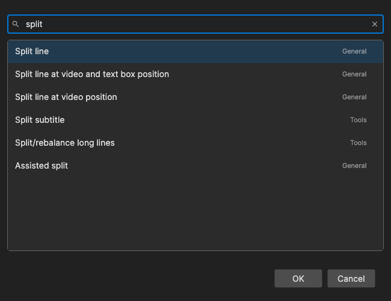

# Command Palette

Find and run any main-window command by typing part of its name, without hunting through the menus.

- **Menu:** Edit → Command palette...
- **Shortcut:** `Ctrl+Shift+K` (`Cmd+Shift+K` on macOS), configurable

The palette lists the same commands as [Options → Shortcuts](shortcuts.md), so commands that have no menu entry and no shortcut can still be reached from the keyboard. Each row shows the command name, its group (File, Edit, Tools, Video, ...) and its current shortcut, if it has one.

## How to Use

1. Press `Ctrl+Shift+K` (or open **Edit → Command palette...**).
2. Type part of a command name. The list narrows with every key press, and the best match is selected.
3. Use the arrow keys to pick another match if needed.
4. Press **Enter** (or double-click a row, or click **OK**) to close the palette and run the command.

## Searching

- **Every word must match.** Type several words separated by spaces, in any order - `merge short` and `short merge` both find *Merge short lines*. A word can match the command name, its group name, or its shortcut keys, so `ctrl+s` or `tools` also work.
- **Initials.** A single word can be the first letters of the command's words: `fce` finds *Fix common errors*, `bc` finds *Batch convert*.
- **Ranking.** Commands whose name starts with what you typed come first, then initials matches, then names where every word starts a word in the name, then names that contain the text anywhere.
- **Recently used first.** With an empty search box, the commands you ran from the palette most recently are listed at the top (the last 10), followed by the rest in alphabetical order. Among equally good matches, recently used commands also win. The recent list lasts until Subtitle Edit is closed.
- When nothing matches, "No matching commands" is shown.

Text box commands (the ones that only act on a focused text box, like the shortcuts in the text box category) are not listed, because the palette itself has the focus when you pick a command. The palette does not list itself.

## Keyboard Shortcuts

| Key | Action |
|-----|--------|
| Enter | Run the selected command |
| Up / Down | Select the previous / next command |
| Page Up / Page Down | Move the selection 10 commands up / down |
| Escape | Close without running anything |
| F1 | Show help (default key, [changeable](shortcuts.md#worth-knowing)) |

To change the palette's own shortcut, look for **Command palette** in [Options → Shortcuts](shortcuts.md).
