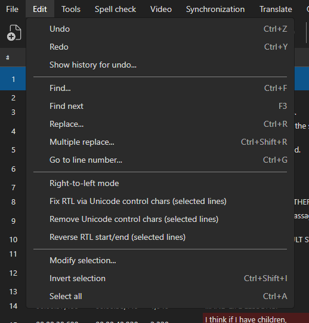
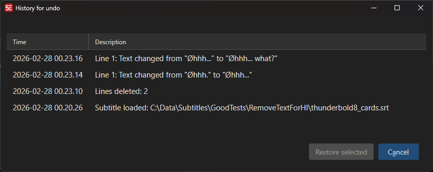
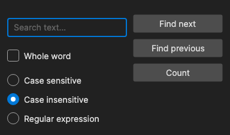
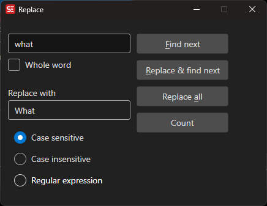
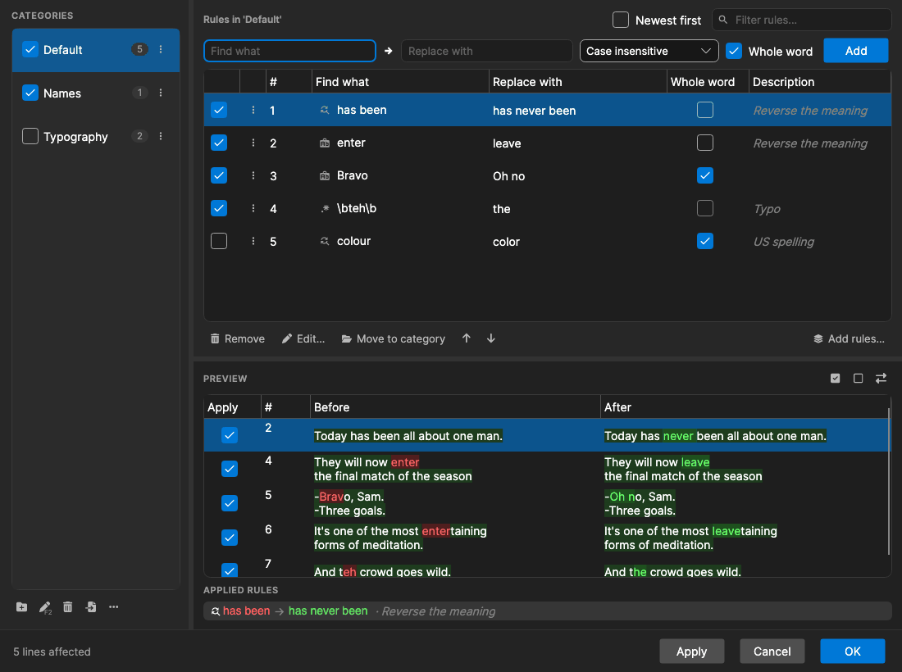

# Edit Menu

The Edit menu provides tools for finding, replacing, and modifying subtitle text and selections.

<!-- Screenshot: Edit menu -->


## Undo / Redo

Undo or redo the last editing action.

- **Undo:** `Ctrl+Z`
- **Redo:** `Ctrl+Y` (`Cmd+Shift+Z` on macOS)

## Show History

View the complete history of changes made to the subtitle file and restore any previous state.

<!-- Screenshot: Show history window -->


## Find

Search for text in the subtitle.

- **Menu:** Edit → Find
- **Shortcut:** `Ctrl+F`
- **Find next:** `F3` (`Cmd+G` on macOS)
- **Find previous:** `Shift+F3` (`Cmd+Shift+G` on macOS)

Options:
- Whole word (checkbox)
- Search type (radio buttons): Case sensitive, Case insensitive, or Regular expression

With **Regular expression** selected, right-click the search box for a helper flyout that inserts common regex building blocks.

> **Matching a line break with a regular expression:** use `\n` between the words on the two lines (for example `ear\ntwice`). `\r\n` and `\r` are accepted too and are treated the same as `\n`, so a rule works regardless of how it was written or which platform created it.

> **`^` and `$` in Find and Replace** match the start and the end of the whole subtitle text, so in a two-line subtitle `^-` only finds the dash on the first line. Write `(?m)` in front of the pattern - `(?m)^- ` - to make them match at every line break instead. (Multiple replace is the other way around, see below.)

> **Slow patterns:** a pattern that has not finished with a single subtitle after five seconds is given up on and treated as no match for that subtitle, so an expression that backtracks forever - `(a+)+b` and friends - cannot lock up the program.

> **Translator mode:** with an original subtitle loaded, both the text and the original text are searched. Within a line the text is searched first, then the original text, and the match is selected in the text box of the column it was found in.

<!-- Screenshot: Find window -->


## Replace

Find and replace text in the subtitle.

- **Menu:** Edit → Replace
- **Shortcut:** `Ctrl+H` (`Cmd+Option+F` on macOS, since Cmd+H hides the app)

The buttons have Alt accelerators, underlined while Alt is held: `Alt+F` **Find next**, `Alt+R` **Replace & find next**, `Alt+A` **Replace all**. As in Subtitle Edit 4, the bare letter (`F`, `R`, `A`) also works once the focus has left the text boxes, e.g. after clicking a button. The Find window has `Alt+F` **Find next** and `Alt+P` **Find previous** the same way. The history button next to the search box lists recent searches. Each entry has a **✕** to delete it (in the history menu and in the search box's drop-down; `Delete` on a highlighted entry does the same), and **Clear history** at the bottom of the menu removes them all. `Ctrl+Delete` removes the current search text from the search history.

The line under the buttons reports the outcome: **Count** shows how many matches there are, **Replace all** shows how many occurrences were replaced, and **Replace & find next** keeps a running total of the occurrences replaced with the current search text. Typing a new search text starts the count over.

**Replace all** starts at the selected line and replaces down to the end of the file. If it did not start on the first line, it then asks whether to continue from the top; **Yes** replaces in the lines above the starting line too, so no line is replaced twice. Both passes are one undo step.

With an editable original subtitle loaded, a **Replace/search in** drop-down appears with three choices:

- **Text and original text** - both columns (the default, and what Find always does)
- **Text only** - leave the original subtitle alone
- **Original text only** - only change the original subtitle

The choice is remembered between sessions. It also applies to `F3` / `Shift+F3` until the Find window is used again, which always searches both columns. The drop-down is hidden when there is no original subtitle, or when the original is opened as a read-only reference - a read-only original is never written to.

> **Replacement text:** group references work - `$1`, `$&`, `${name}` - and `\n` inserts a line break. Other backslash escapes are not expanded there: `\t` and `\u00A0` are inserted as those literal characters. To insert a special character, paste the character itself into the **Replace with** box. In the search pattern all .NET escapes work as usual, `\u00A0` included.

<!-- Screenshot: Replace window -->


## Multiple Replace

Apply multiple find-and-replace rules at once, organized into named categories. Rules are persisted across sessions.

- **Menu:** Edit → Multiple replace

<!-- Screenshot: Multiple replace window -->


### Window layout

The window is split into two resizable panels:

| Panel | Description |
|---|---|
| **Left — Rules** | Tree of categories and their rules. Each rule shows its type icon, find pattern, replacement, and an optional description. The buttons above the tree add a category, add a rule, open **Add rules** (a whole list in one go), import rules, and collapse or expand all categories. |
| **Right — Fixes** | Preview of all lines that will be changed. The **Before** column highlights removed characters in red and the **After** column highlights added characters in green. Selecting a row reveals an **Applied rules** detail panel at the bottom listing every rule that matched that line. |

### Choosing which fixes to apply

Every line in the preview starts ticked in the **Apply** column, and only ticked lines are changed by **OK** or **Apply**. Untick a line to leave it as it is.

Right-click the preview to tick or untick many rows at once:

- **Select all** (`Ctrl+A`) — tick every row
- **Select none** (`Ctrl+D`) — untick every row, so single rows can be picked
- **Invert selection** (`Ctrl+Shift+I`) — tick the unticked rows and untick the ticked ones

`Space` toggles the checkbox of the rows that are highlighted, so a range selected with Shift+click can be flipped in one go. These gestures work while the preview has focus; the rules tree keeps its own shortcuts below.

Editing a rule regenerates the preview, which ticks every row again.

### Rule types

Each rule has one of three match types, shown as an icon in the tree:

| Type | Description |
|---|---|
| Case insensitive | Plain text match, ignores case |
| Case sensitive | Plain text match, exact case |
| Regular expression | Full .NET regex syntax. Use `\n` to match a line break between two lines (`\r\n` and `\r` are accepted too and treated as `\n`). |

The **Whole word** checkbox in the rule dialog makes a plain-text rule match only whole words (it is disabled for regular expression rules, where `\b` does the same).

Unlike Find and Replace, regular expression rules here are matched in multiline mode: `^` and `$` match at the start and the end of *every* line, so `^- ` strips the dash from both lines of a two-line subtitle. Put `(?-m)` in front of the pattern to anchor to the whole subtitle text instead. In the replacement, `$1` and `\n` work like in Replace above, and regular expression rules here also support the case conversion escapes `\u` / `\l` (next character to upper / lower case) and `\U` / `\L` (upper / lower case until `\E` or the end). For example `^(?:Um|Uh),\s*(\w)` replaced with `\u$1` removes a leading "Um, " and capitalizes the word after it, and `\u\L$1` gives "Word" for "wORD". Write `\\u` for a literal `\u`; other backslash escapes are not supported. The Replace window does not support the case conversion escapes.

> **Slow patterns:** the same five-second match timeout as in Find applies to each rule on each line. A rule that runs out of time is retired for the rest of the pass and flagged in the tree with "Regular expression gave up after 5 seconds - the rule is skipped, try a simpler pattern", so a catastrophically backtracking pattern shows up as an error rather than as a rule that silently matches nothing. The timeout is fixed; there is no setting for it.

### Managing categories

Right-click a category node to open its context menu:

- **Edit** — rename the category
- **New category** — add a sibling category
- **New rule** — add a rule to this category
- **Add rules...** — add a list of rules to this category in one go (see [Adding many rules at once](#adding-many-rules-at-once))
- **Move up / Move down** — reorder categories
- **Move to top / Move to bottom** — move the category to the first or last position
- **Delete** — remove the category and all its rules
- **Import** — load rules from a `.template` file (JSON or legacy SE4 XML), a `.csv` file, or a Subtitle Edit 4 `Settings.xml` (its multiple replace groups are imported directly)
- **Export** — save selected categories to a `.template` (JSON) or `.csv` file

### Managing rules

Right-click a rule node to open its context menu:

- **Edit rule** — change find/replace text, type, and description
- **Duplicate** — insert a copy of the rule above the current one
- **Insert before / Insert after** — add a new rule relative to this one
- **Add rules...** — add a list of rules right after this one (see [Adding many rules at once](#adding-many-rules-at-once))
- **Move up / Move down** — reorder within the category
- **Move to top / Move to bottom** — move the rule to the first or last position in the category
- **Move to category** — move the rule to the end of another category
- **Delete** — remove the rule

Double-clicking a rule also opens the **Edit rule** dialog. A new rule is selected and scrolled into view, also at the end of a long category.

### Adding many rules at once

**Add rules** (the toolbar button, the context menu, or `Ctrl+Shift+N`) opens one window for a whole list of find/replace pairs - a word list does not need a **New rule** dialog per word. The rules go to the end of the selected category, or right after the selected rule.

- Type the text in **Find what** and **Replace with** and press `Enter`: the pair is added to the list below and the cursor goes back to **Find what** for the next one. `Tab` moves between the two boxes.
- The type (case insensitive, case sensitive, regular expression) and **Whole word** stay as set for every rule you enter. They start as the neighbouring rule's, so a list of words usually needs them set once.
- Double-click a row in the list (or press `Enter` on it) to take it back into the boxes and correct it; `Delete` or the trash button removes it.
- **OK** (or `Ctrl+Enter`) adds the list to the category; a pair still in the boxes is added too. **Cancel** asks before throwing away a list that was entered.

The rules are added in the order they were entered, which is the order they run in.

### Keyboard shortcuts

| Shortcut | Action |
|---|---|
| `Ctrl+N` | Add a new rule to the selected category, or insert after the selected rule |
| `Ctrl+Shift+N` | Open **Add rules** for the selected category or rule |
| `F2` | Edit the selected rule, or rename the selected category |
| `Ctrl+D` | Duplicate the selected rule |
| `Ctrl+F` | Find a rule by name / text |
| `Ctrl+Up` / `Ctrl+Down` | Move the selected category or rule up / down (`Cmd` on macOS) |
| `Ctrl+Home` / `Ctrl+End` | Move the selected category or rule to the top / bottom (`Cmd` on macOS) |
| `Ctrl+Shift+-` | Collapse all categories |
| `Ctrl+Shift++` | Expand all categories |
| `Delete` | Delete the selected rule (focus must be in the rules tree) |
| `Space` | Toggle the selected node (category or rule) on/off |
| `Escape` | Close the window |
| `F1` | Open help |

On macOS `Cmd` works for every `Ctrl` shortcut above. The context menus show the shortcut next to each action.

The expand/collapse buttons (`+` / `−`) above the tree expand or collapse all categories at once (`Ctrl+Shift++` / `Ctrl+Shift+-`).

> **Note:** `Ctrl+D` duplicates the selected rule, except while the fixes preview has focus — there it unticks every row, as in the other preview lists (see [Choosing which fixes to apply](#choosing-which-fixes-to-apply)).

### Import / Export

Rule sets are stored as JSON `.template` files and can be shared across installations. The export dialog lets you choose which categories to include. SE4-format XML files can also be imported — both rule files exported from Subtitle Edit 4 and a full Subtitle Edit 4 `Settings.xml` (found in `%AppData%\Subtitle Edit`, or next to `SubtitleEdit.exe` for portable installs), whose multiple replace groups are then imported.

Rules can also be exported to and imported from **CSV** (choose the `.csv` type in the export/import dialog), which is convenient for editing rules in a spreadsheet or sharing them as a simple table.

The CSV has one row per rule with this header:

```csv
Category,Find,ReplaceWith,Description,Active,Type,WholeWord
```

| Column | Description |
|---|---|
| `Category` | Category the rule belongs to (rules with the same name are grouped; empty becomes `Default`) |
| `Find` | Text or pattern to search for |
| `ReplaceWith` | Replacement text (may be empty) |
| `Description` | Optional note |
| `Active` | `true` or `false` — whether the rule is enabled |
| `Type` | `CaseInsensitive`, `CaseSensitive`, or `RegularExpression` |
| `WholeWord` | `true` or `false` — optional; older files without this column import as `false` |

Values are quoted per RFC 4180, so `Find`/`ReplaceWith` may contain commas, double quotes (written as `""`) and line breaks. The header row is optional on import; unknown `Type` values fall back to `CaseInsensitive`. Files are written as UTF-8 (with BOM) so non-ASCII rules open correctly in spreadsheet apps.

Example:

```csv
Category,Find,ReplaceWith,Description,Active,Type
General,"hello, world","say ""hi""",greeting,true,CaseInsensitive
Regex,\d+,#,strip numbers,true,RegularExpression
```

## Go to Line Number

Jump to a subtitle by its line number.

- **Menu:** Edit → Go to line number...
- **Shortcut:** `Ctrl+G` (`Control+G` on macOS, where Cmd+G is find next)

## Command Palette

Search every command by name and run it from the keyboard.

- **Menu:** Edit → Command palette...
- **Shortcut:** `Ctrl+Shift+K` (`Cmd+Shift+K` on macOS)

See [Command palette](command-palette.md).

## Modify Selection

Select or deselect subtitle lines based on rules (e.g., text contains, duration, etc.).

- **Menu:** Edit → Modify selection...

See [Modify Selection](modify-selection.md) for the full list of rules and selection actions.

## Select All

Select all subtitle lines.

- **Shortcut:** `Ctrl+A`

## Inverse Selection

Invert the current selection (select unselected lines, deselect selected ones).

## Toggle Right-to-Left

Toggle right-to-left text direction for languages like Arabic and Hebrew.

Three more right-to-left tools act on the selected lines:

- **Fix RTL via Unicode control chars** — add Unicode right-to-left control characters to the text, for players that ignore the text direction
- **Remove Unicode control chars** — strip those control characters again
- **Reverse RTL start/end** — reverse the start and end of right-to-left lines (for punctuation that ended up on the wrong side)
