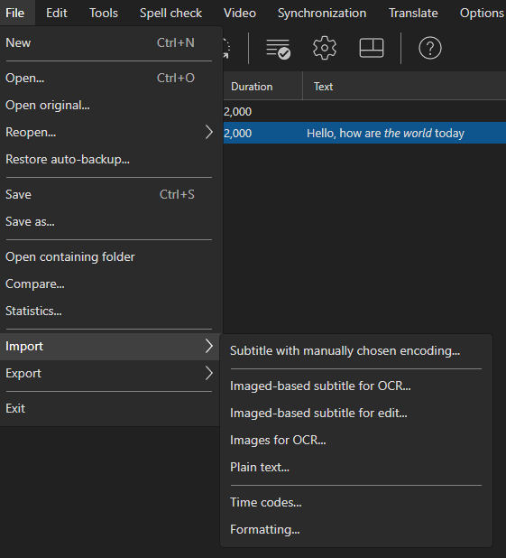
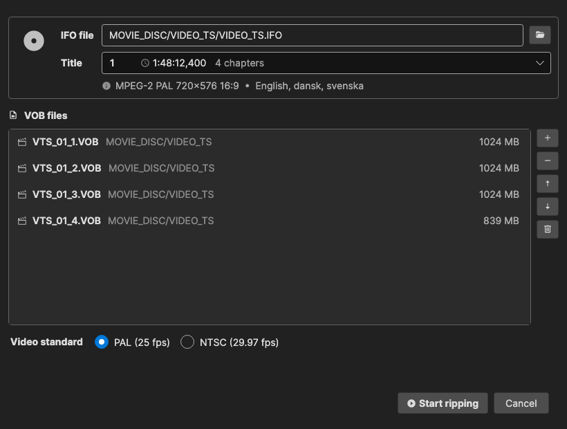
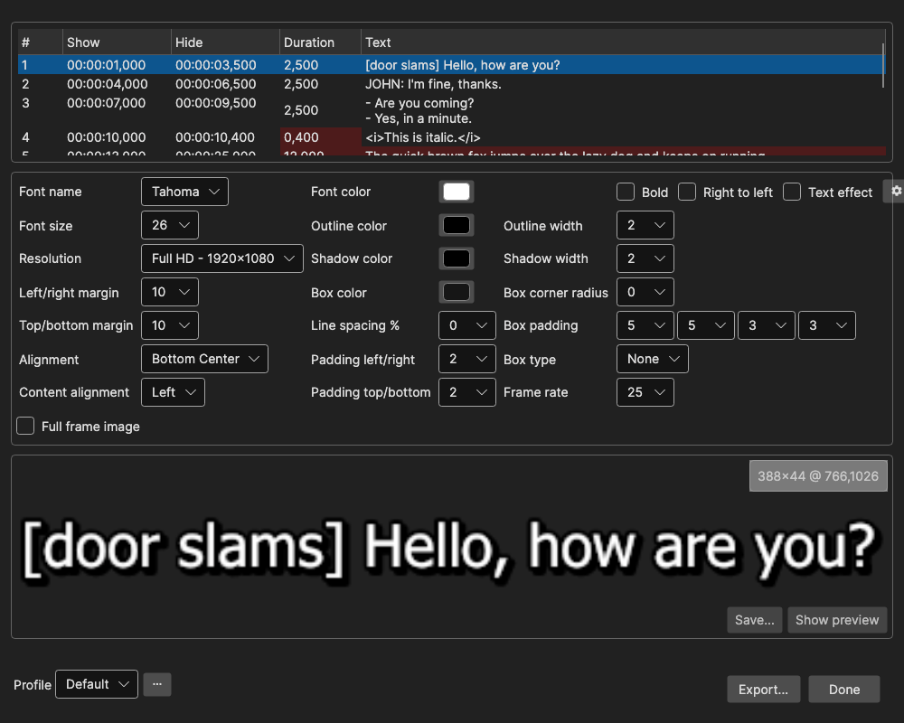
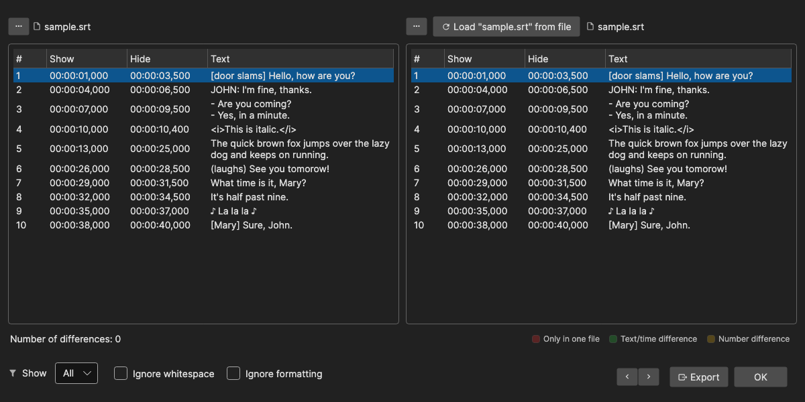

# File Menu

The File menu provides operations for creating, opening, saving, importing, and exporting subtitle files.

<!-- Screenshot: File menu -->

## New

Create a new empty subtitle.

- **Menu:** File → New
- **Shortcut:** `Ctrl+N`

### New (keep video)

Create a new subtitle while keeping the currently loaded video.

### New window

Open another Subtitle Edit main window.

## Open

Open an existing subtitle file.

- **Menu:** File → Open
- **Shortcut:** `Ctrl+O`

The format is detected automatically. A file that no known format claims is tried with the generic importers - plain lines with time codes, CSV, JSON, spreadsheets, and a generic XML importer that finds the repeated element carrying time codes and text in an unknown XML dialect. If that still yields nothing, a `.txt` file goes straight to [Import plain text](import-plain-text.md), as SE 4 did; for other extensions the "unknown subtitle format" error has an **Import plain text** button that sends the file there instead - handy for unsynced lyrics or a script.

### Open (keep video)

Open a subtitle file while keeping the currently loaded video.

### Open original subtitle

Open a second subtitle file for translation mode (shown side by side). See [Translation Mode](main-window.md#translation-mode) for how a file that does not line up 1:1 is handled.

### Edit original subtitle

Toggle "edit original" mode: the original subtitle (even one opened as a read-only reference) becomes the file being edited, and the working subtitle's text box goes read-only. See [Edit original mode](main-window.md#edit-original-mode).

## Save

Save the current subtitle file.

- **Menu:** File → Save
- **Shortcut:** `Ctrl+S`

## Save As

Save the current subtitle to a new file or format.

- **Menu:** File → Save as...
- **Shortcut:** `Ctrl+Shift+S`

Formats new in 5.2 in the format list include EBU-TT (Tech 3350), Csv Excel, Wistia json, DVD Junior SPC, Sonic DVD Producer, YouTube timed text srv3, DaVinci Resolve Marker EDL, Adobe Premiere Markers, Audacity labels and Final Cut Pro Xml Captions - see [Supported Formats](../reference/supported-formats.md).

## Save Forced Lines As

Save only the lines marked as forced (see **Toggle forced** in the [subtitle grid](subtitle-grid.md#context-menu)) to a file.

## Close Original

Close the secondary (original) subtitle file in translation mode.

## Close Translation

Shown while an editable original is open: closes the translation and makes the original the working subtitle. The translation file on disk is not changed.

- You are always asked first: with unsaved changes you get the usual save prompt, otherwise a confirmation ("Close the translation ...? The original subtitle ... becomes the subtitle you edit."), since the item sits right next to **Close original** in the menu.
- When the original lines up with the translation, the rows keep their time codes and the original text moves into the text column.
- When the original does **not** line up 1:1 (see [Translation Mode](main-window.md#translation-mode)), the original subtitle itself - with its own lines and time codes, and any edits you made to the original text - becomes the working subtitle. The translation's timing is not carried over.
- Not offered when the original is a read-only reference.

## Format Properties

Formats with their own settings (ASSA, EBU STL, PAC, ...) get a **<format> properties...** item here, opening the same dialog as the gear button next to the format combo box.

## Reload When Changed Outside Subtitle Edit

When the open subtitle file is changed by another program - another editor, a script, a sync tool - Subtitle Edit notices it when you switch back to its main window:

- **No unsaved changes:** the file is reloaded right away, and the status bar shows "Subtitle reloaded (changed outside Subtitle Edit)".
- **Unsaved changes:** you are asked "The file ... was changed outside Subtitle Edit. Reload it and lose your changes?" Answer **No** to keep your edits; you are not asked again until the file changes once more.

The reload keeps the video, the selected line, the encoding, the original subtitle in translation mode, the video offset and SMPTE timing. There is no live file watcher: the file's time stamp and size are compared when the window is activated. A converted import (for example a file opened from a video container) is not checked, and a file that is missing or empty (likely still being written) is skipped until the next time. There is no setting for this.

## Recent Files

Quick access to recently opened subtitle files.

## Import

### Import subtitle with manually chosen encoding

Open a subtitle file with a specific text encoding.

### Import time codes

Import time codes from another subtitle file, applying them to the current text.

### Import plain text

Import plain text and create subtitle lines from it, with optional forced-aligner timing against the video's audio.

See [Import Plain Text](import-plain-text.md) for details.

### Images for OCR

Import image files and create subtitle entries from them.

### Import image-based subtitle for OCR

Read the subtitles out of an image-based file (Blu-ray `.sup`, VobSub `.sub`, `.ts`, BDN xml) and run [OCR](ocr.md) on them to get editable text.

### Import subtitles from DVD

Rip the subtitles of a DVD title straight from its IFO and VOB files, then [OCR](ocr.md) them to text.

- **Menu:** File → Import → Subtitles from DVD (IFO/VOB)...

1. Click the folder button next to **IFO file** and open the title set's IFO file (for example `VIDEO_TS\VTS_01_0.IFO`), or click **Add VOB files** - or drop IFO/VOB files on the window
2. With an IFO, pick the **Title**. Each title shows its duration, number of chapters and subtitle languages; the longest complete title is selected. Opening `VIDEO_TS.IFO` lists the titles of every title set. A title whose VOB files are not all there is marked "VOB files missing (x% found)"
3. Check the **VOB files** list - the title's VOB files are filled in. **Remove**, **Move up**, **Move down** and **Clear** edit the list
4. Check the **Video standard** - *PAL (25 fps)* or *NTSC (29.97 fps)*, taken from the IFO when there is one
5. Click **Start ripping**. **Abort** (or Escape) stops it
6. When the DVD has several subtitle streams, pick the language in the next window; then the [OCR](ocr.md) window opens with the chosen stream

Ripping a title from its IFO reads only that title's cells, in play order. If you edit the VOB list, all listed VOB files are read instead. The palette and the stream languages come from the IFO (also for loose VOB files when the title set's IFO is next to them), and the language is passed on to OCR.

Subtitle Edit does not decrypt CSS. If the VOB files were copied from a DVD without decrypting, a warning tells how many subtitle packets are still encrypted (their images would be garbled) and asks whether to continue - decrypt the DVD with a ripping tool first for a clean result.

**File → Open** on an `.ifo` file opens this window with it, and opening a single `.vob` file with subtitles goes straight to the language pick and OCR.

### Other sources opened with File → Open

These are recognised when opened with **File → Open** (or **Import → Image-based subtitle for OCR...**):

- **PSP UMD Video** - `.mps` and `.pmf` files (and `.subs` dumps of their subtitles): the subtitle images are read, you pick the stream when there are several, and they go to [OCR](ocr.md)
- **HD-DVD `.sup`** - HD-DVD subpicture files are read and sent to [OCR](ocr.md)
- **CEA-608 closed captions in MPEG video** - DVD `.vob` files without subpictures, program streams (`.mpg`, `.mpeg`, `.m2p`) and bare MPEG video (`.m2v`, `.m1v`, `.mpv`) are searched for Line 21 / ATSC A/53 / SCTE 20 closed captions; you pick the caption track when there are several, and the captions are loaded as text

### Import image-based subtitle for edit

Open an image-based subtitle in the [image-based subtitle editor](binary-edit.md) — moving, resizing and re-colouring the bitmaps — without converting them to text.

### Import CSV/XLSX/ODS with custom columns

Import a spreadsheet or delimited text file and choose which column holds the start time, end time, text, and so on.

See [Import Spreadsheets](import-csv-xlsx.md) for details, including the column names that are recognised automatically when a spreadsheet is opened directly.

### Import formatting

Copy the formatting — italic/bold/underline, font tags and ASSA override tags — from another subtitle file onto the currently loaded lines, matched line by line. A warning is shown first when the two files do not have the same number of lines.

## Export

### Export as plain text

Export subtitle text without time codes.

### Export custom text format

Export using a customizable text template. A template has a header, a per-subtitle text part, and a footer.

Placeholders for the text part include `{start}`, `{end}`, `{text}`, `{number}`, `{number-1}`, `{duration}`, `{gap}`, `{actor}`, `{text-line-1}`, `{text-line-2}`, `{text-length}`, `{cps-period}`, `{bookmark}`, `{text-csv}`, and `{tab}`.

The header and footer take `{title}`, `{#lines}`, `{tab}`, `{media-file-name}`, `{media-file-name-full}` and `{media-file-name-with-ext}`.

The time code format is built from these letters (anything else is kept as-is):

| Letters | Meaning |
|---------|---------|
| `hh` / `h` | hours |
| `mm` / `m` | minutes |
| `ss` / `s` | seconds |
| `zzz` | milliseconds / fraction of a second |
| `ff` / `f` | frames (uses the current frame rate) |

So `hh:mm:ss,zzz` gives `00:01:01,160` and `hh:mm:ss:ff` gives `00:01:01:04`.

A time code format that *starts* with `s`'s or `z`'s means totals instead of clock components: `ss.zzz` gives total seconds `61.160`, `ss.zzzzzz` gives `61.160000` (Audacity/Tenacity label style), `ss` gives `61`, and `zzz` gives total milliseconds `61160`. A format of exactly `ff` gives total frames.

### Export to Blu-ray SUP

Export subtitles as Blu-ray SUP image format.

Start and end times are written on the video's frame grid, using the window's **Frame rate**, which is also stored in the file. When a video is open, the frame rate is taken from it for this export (the profile keeps its own frame rate unless you change it in the window). Without a video, the profile's frame rate is used - make sure it matches the video, or every subtitle may be moved by up to half a frame. A subtitle shorter than half a frame that would overlap the next one on the frame grid is left out.

The image export window is shared by all image-based formats. For 3D video, set **3D** to *Half side-by-side* or *Half top/bottom*. Each image then holds a squeezed copy of the subtitle for each eye, placed by the alignment and margins. **Depth** moves the two copies apart: positive values bring the subtitle out of the screen, negative values push it back. For D-Cinema only **Z-position** is shown, which is written to each image in the XML.

A 3D Blu-ray stores the depth of its subtitles for every frame, in "3D-Planes". To give each subtitle the depth the disc gives it, click the folder button next to **3D-Plane** and open the `.ofs` file for the track's 3D-Plane. BD3D2MK3D and OFSExtractor make these files, and tsMuxeR shows which 3D-Plane a subtitle track uses. Each subtitle then gets the depth nearest to the viewer during the frames it is shown on. **Depth** is used for subtitles whose frames have no depth in the 3D-Plane. The 3D-Plane is not saved in the profile, because it belongs to one movie. Batch convert uses a 3D-Plane saved next to each input file with the same name (`movie.sup` + `movie.ofs`), when a 3D mode is set in the export profile.

### Export to EBU STL

Export subtitles in EBU STL format (used in European broadcasting).

### Export to PAC

Export subtitles in PAC format. Pick the **code page** for the text. A subtitle with lines in two scripts (e.g. Hebrew with a Russian line under it) can also get a **Secondary code page**: each line that fits it better is written with it and flagged as a secondary code page line. Opening a PAC file detects both code pages automatically.

### Export to Cavena 890

Export subtitles in Cavena 890 format.

### Export image-based

Export subtitles as images. The Export submenu lists: Blu-ray (sup), BDN/xml, BDN/xml 8-bit, IMSC 1.1 image profile, CapMaker Plus, Cheetah Caption, Cheetah Caption Old, Cavena 890, DVB teletext (Manzanita), D-Cinema interop/png, D-Cinema SMPTE 2014/png, EBU STL, DOST/png, DVD sup (MuxMan/Scenarist), Final Cut Pro + image, Images with time code, PAC (Screen Electronics), PAC Unicode (UniPac), VobSub (sub/idx) and WebVTT png — followed by **Custom text formats...** and **Plain text...**.

**BDN/xml** writes 32-bit PNGs; **BDN/xml 8-bit** writes the same index.xml with 8-bit palette-indexed PNGs, which is what most Blu-ray authoring tools expect.

The **IMSC 1.1 image profile** export writes the TTML file plus one PNG per subtitle next to it, named after the TTML file (`movie.ttml`, `movie_0001.png`, `movie_0002.png`, ...). Each subtitle is a `div` whose `smpte:backgroundImage` names its PNG, with media timebase, percentage-positioned regions, and `itts:forcedDisplay` on forced subtitles. The PNGs are separate files because the image profile does not allow embedded images. Keep them together with the TTML file when you deliver it.

**Characters missing from the font.** If the chosen font has no glyph for a character, such as the music note ♪ in Times New Roman or Open Sans, that character is drawn with another installed font that has it, as text boxes on screen do. The rest of the line keeps the chosen font. This also works inside right-to-left lines, for example Arabic or Hebrew with a font that only covers Latin text.

#### Text effects

Tick **Text effect** (next to the bold and right-to-left check boxes) and press the settings button beside it to pick a **Preset** and tune it with **Strength**, **Letter spacing**, **Curve** and **Wave**. Every size in a preset scales with the font size, and presets use the window's font, outline and shadow colours where that is natural (the "signature" looks such as gold, chrome and fire bring their own palette). The presets, as listed in the settings window:

- Shadow and outline: Soft shadow, Double outline, Hollow (outline only), Emboss, Comic book
- Glow and 3D: Neon glow, 3D extrude, 3D glasses, Retro 80s
- Gradients and materials: Gradient (gold), Chrome, Brushed steel, Ice, Fire, Lava, Marble, Wood
- Patterns: Rainbow, Candy cane, Polka dots

The same setting is used by Batch convert's image-based output, so the two cannot drift apart.

#### ASSA override tags

Tags in the text are read rather than drawn as literal characters:

| Tag | Effect on the exported image |
|-----|------------------------------|
| `{\an1}` - `{\an9}` | Places the subtitle, overriding the alignment chosen in the window |
| `{\pos(x,y)}` | Positions the subtitle (coordinates are in the script's own resolution) |
| `{\i1}`, `{\b1}`, `{\c&H..&}`, `{\fn..}`, `{\fs..}` | Italic, bold, colour, font and size |
| `{\alpha&H80&}`, `{\1a}`, `{\3a}`, `{\4a}` | Transparency — all parts at once, or text, outline and shadow separately |
| `{\3c&H..&}`, `{\4c&H..&}` | Outline and shadow colour, overriding the colours chosen in the window |
| `{\bord2}`, `{\shad0}` | Outline and shadow width (in the script's own resolution) — `{\bord0}` turns the outline off |
| `{\fad(in,out)}`, `{\fade(..)}` | Fade in/out — **Blu-ray SUP only** (see below) |

Anything else is removed before rendering.

**Fading (Blu-ray SUP).** A subtitle with `{\fad(400,400)}` is written the way a Blu-ray disc does it: the image is encoded once and the fade follows as palette updates, one per video frame, which cost about a kilobyte each instead of a whole new image. Long fades are sampled coarser so a single subtitle never adds more than 60 of them. The other image formats have no way to animate a subtitle and ignore the tag - the image is written fully opaque.

**Overlapping subtitles (Blu-ray SUP).** Subtitles that are on screen at the same time - a line at the bottom and a `{\an8}` line at the top, say - are shown together. A Blu-ray display set can compose two images in two windows, so the export cuts the timeline wherever a subtitle starts or ends and writes one display set per slice with everything on screen in it. Subtitles that would be drawn over each other, and a third one at the same time, are drawn into one image, the later one on top - the same as the preview shows. A fade on one of the lines still fades that line only.

<!-- Screenshot: Export image-based window -->

## Compare

Compare two subtitle files side by side.

- **Menu:** File → Compare...

<!-- Screenshot: Compare window -->

## Statistics

View subtitle file statistics (character count, line count, reading speed, etc.).

- **Menu:** File → Statistics...

## Restore Auto Backup

Restore a previously auto-saved backup of a subtitle file.

- **Menu:** File → Restore auto-backup...

The **Settings** tab lists the backups of `Settings.json` (your settings and shortcuts):

- A backup is taken when Subtitle Edit starts, if the newest one is older than the **Settings backup interval (days)** from Options → Settings - `0` means every start. It is skipped when nothing but the recent files lists has changed since the newest backup.
- **Back up now** takes a backup right away, e.g. before editing `Settings.json` by hand.
- **Restore settings** replaces the current settings with the selected backup. The current settings are backed up first, so a restore can be undone. Some changes only take effect after restarting Subtitle Edit.
- Only the newest backups are kept (30 by default).

## Open Containing Folder

Open the folder containing the current subtitle file in the file manager.
