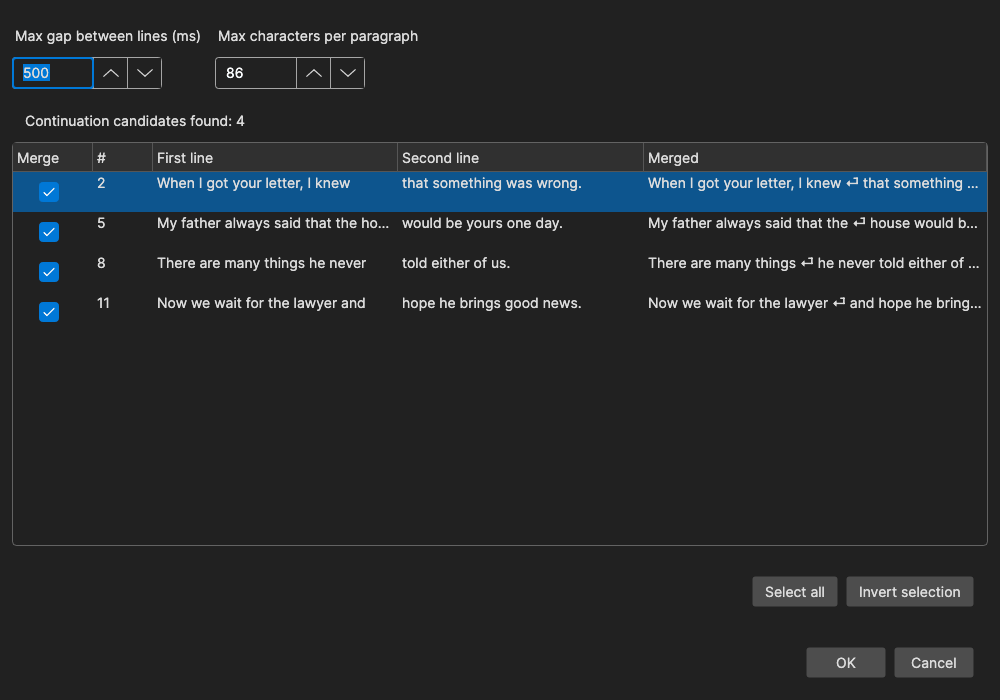

# Merge Continuation Lines

Merge subtitles where one sentence has been split across two or more consecutive lines, with a preview of every merge before anything is changed.

- **Menu:** Tools → Merge continuation lines...
- **Shortcut:** Configurable (no default)

Unlike [Merge Short Lines](merge-short-lines.md), which merges by length, this tool looks at punctuation: a line that does not end a sentence is joined with the line after it. This is useful for subtitles made by speech recognition or for scripts that will be read by [Text to Speech](text-to-speech.md), where a sentence spoken as one unit sounds more natural.

## How to Use

1. Open **Tools → Merge continuation lines...**
2. Adjust **Max gap between lines (ms)** and **Max characters per paragraph** - the list of candidates updates as you change them.
3. Uncheck any merge in the **Merge** column you do not want. **Select all** and **Invert selection** change all the check boxes at once.
4. Click **OK** to apply the checked merges.

The status line shows how many candidates were found ("Continuation candidates found: 12") or "No continuation candidates found". The merge can be undone with **Edit → Undo**.

## What Counts as a Continuation

Two consecutive lines are offered for merging when all of these hold:

- The first line does **not end a sentence** - it does not end with `.`, `!`, `?` or a sentence-ending mark of the subtitle's language (detected automatically), also when a closing quote follows the mark. A line ending with an ellipsis (`...` or `…`) counts as unfinished and *is* merged. Formatting tags are ignored when checking.
- The **gap** from the end of the first line to the start of the next is less than **Max gap between lines (ms)**.
- The two texts together (without formatting tags) are shorter than **Max characters per paragraph**.
- Neither line is a **dialog line** starting with a dash (`-`, `‐`, `–`, `—`) - those are two speakers, not one sentence.
- Neither side is a **music line** - the first line ending with `♪`/`♫`, or the next one starting with it.

An empty first line also qualifies. When several lines in a row qualify, they are all merged into one subtitle.

## The Merge

The merged subtitle starts at the first line's start time and ends at the last line's end time. The texts are joined with a space and re-broken with auto-break for the subtitle's language. The **Merged** column shows exactly the text that will be written.

## Options

| Option | Description | Default |
|--------|-------------|---------|
| Max gap between lines (ms) | Lines further apart than this are never merged (0-10000) | 500 |
| Max characters per paragraph | Upper limit for the merged text (20-1000) | Max line length × max number of lines from Options → Settings |

The values are remembered for the next time the tool is opened from the Tools menu.

## Other Places

- **[Text to Speech](text-to-speech.md#merge-continuation-lines)** - before generating, Subtitle Edit offers to merge continuation lines (using a 500 ms gap and 500 characters), so each sentence is spoken in one go. Turn the prompt off with **Text to speech: prompt to merge continuation lines** in **Options → Settings → Tools**.
- **[Batch Convert](batch-convert.md)** - *Merge continuation lines* is one of the batch functions, with its own max gap and max characters.
- **[Command line (seconv)](../reference/command-line.md#operations)** - `--merge-continuation-lines`, with `--merge-continuation-lines-max-gap:<ms>` and `--merge-continuation-lines-max-chars:<n>` for the limits.

## Keyboard Shortcuts

| Key | Action |
|-----|--------|
| Escape | Close without changes |
| F1 | Show help (default key, [changeable](shortcuts.md#worth-knowing)) |
