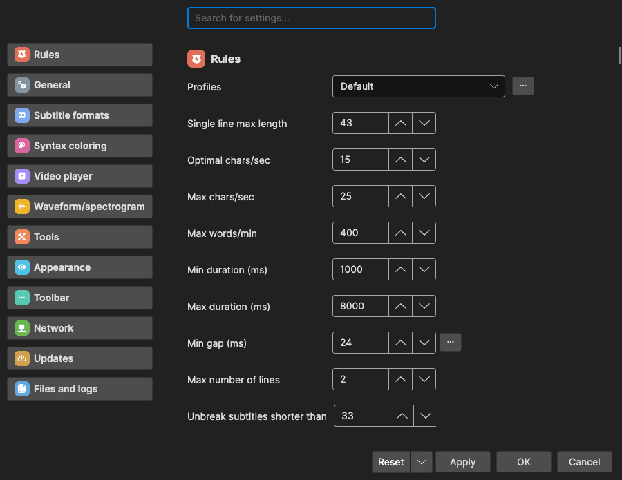

# Settings

Configure application preferences, rules and profiles, appearance, video player, waveform, and more.

- **Menu:** Options → Settings...
- **Shortcut:** Configurable

<!-- Screenshot: Settings window -->

## How to Use

1. Open **Options → Settings...**
2. Pick a section from the icons on the left, or type in the **Search for settings...** box at the top to jump to a setting by name
   - **Alt+Left** / **Alt+Right** (**Cmd+[** / **Cmd+]** on macOS) go back and forward through the sections you have visited, like in a web browser. The history is forgotten when Settings closes
3. Adjust settings as needed
4. Click **OK** to save

The window is split into sections; the list below follows the order they appear in. Some sections and options only show up on the platform they apply to.

## Rules

The subtitle rules that drive error checking, the grid's warning colors, and tools such as [Fix common errors](fix-common-errors.md).

- **Profiles** — Rules are stored per profile, so you can switch between e.g. Netflix, Amazon Prime, Arte, broadcast and default. Built-in profiles include **TikTok/YouTube-shorts (9:16)** (24 chars, 2 lines) and **TikTok/YouTube-shorts (1-3 words)** (one short line per cue). Profiles can be exported and imported
- **Single line max length**, **Optimal chars/sec**, **Max chars/sec**, **Max words/min**
- **Min duration (ms)**, **Max duration (ms)**
- **Min gap (ms)** — The "..." button opens a calculator: pick a frame rate and a number of frames and it works out the milliseconds. It opens on the current video's frame rate and the frame count already configured. Shown in millisecond mode only; in frame mode the value is entered in frames
- **Max number of lines**, **Unbreak subtitles shorter than**
- **Dialog style**, **Continuation style** — Including a custom continuation style editor
- **Cps/line-length** — Which characters count towards CPS and line length

## General

- **Default new subtitle duration (ms)** - The duration a newly inserted subtitle gets, e.g. when inserting at the video position
- **Time up/down increment (ms)** - The step of the start/end/duration up-down boxes in millisecond mode
- **Move selected lines shortcut step (ms)** and **Move start/end shortcut step (ms)** - How far the move shortcuts shift lines or their start/end
- **Move lines: shorten previous/next line instead of overlapping it**
- **Prompt before delete**, **Lock time codes**, **Remember window position and size**
- **Show full file path in title bar** — Show the subtitle file's full path in the main window title instead of only its name. Off by default
- **Show recent files (for reopen)** — Turn off to stop recording recent files; this also hides the Reopen menus and clears the lists
- **Time code mode** — How times are shown and typed: *Time (hh:mm:ss,zzz)* with milliseconds, *Frames (hh:mm:ss:ff)*, or *Frame numbers* - the absolute frame number at the current frame rate (e.g. 15230), also for durations and the video position, so a sync offset is just "video frame - start frame". Both frame modes snap edited times to frames. The mode is also shown in the status bar - click it (or use the "Cycle time code mode" shortcut) to cycle through the three.
- **Store times on video frames (not frames within each second)** — Only for *Frames (hh:mm:ss:ff)*, off by default. Stores each time at the exact time of a real video frame, so the milliseconds in a saved `.srt` match the video and a Blu-ray sup export. See [Frames and video frames](#frames-and-video-frames) below.
- **Limit number of lines in subtitle text box**
- **Open last recent file on start**
- **Auto-convert encoding to UTF-8 on open**, **Force CR+LF on save (text subtitle files)** (also used by [Batch convert](batch-convert.md)), **Auto-trim white-space**
- **Warn on save when lines exceed the format's limits (e.g. SCC 32 chars/line)**
- **Remove blank lines when opening a subtitle** — Off by default
- **Copy text via xclip/wl-copy (keeps accented characters)** — Linux only
- **Default encoding**
- **Subtitle grid Enter-key / single-click / double-click action** — What each gesture does to the video position and focus
- **Subtitle grid, center when selecting prev/next row**
- **Save as behavior**, **Save as: append language code**, **Default save location** (with a custom folder)
- **Auto-save** — Save the open file while editing
- **Auto-backup** — Automatic backups every **Auto-backup interval (minutes)**, with a restore dialog, and **Auto-backup retention (days)** for how long they are kept
- **Auto-backup settings** — Keeps dated copies of `Settings.json` (settings and shortcuts). **Settings backup interval (days)** sets how often: the check runs when Subtitle Edit starts, and `0` means every start. A backup is skipped when nothing but the recent files lists has changed since the newest backup. **Settings backups to keep** sets how many copies are kept (default 30). Restore them from File → Restore auto-backup → Settings

### Frames and video frames

At 25, 24, 30 or 50 fps a second holds a whole number of frames, so there is nothing to choose here. At **23.976, 29.97 and 59.94 fps** it does not, and the two ways of counting frames end up slightly different.

- **The video** counts its frames from the start without stopping: frame 0, 1, 2, ... At 23.976 fps each frame is about 41.708 ms, and every frame has one exact time.
- **hh:mm:ss:ff** shows whole seconds plus the frame within that second (0-23). Since a real second holds a little fewer than 24 frames, this count slowly slides away from the video's frames, up to one frame, and then lines up again.

By default, a time typed or snapped in frame mode is stored on the hh:mm:ss:ff count: `00:01:58:22` is stored as 118 s + 22 frames = **00:01:58,918**. The video frame shown at that point starts at **00:01:58,910**. Turn on **Store times on video frames (not frames within each second)** and `00:01:58:22` is stored as **00:01:58,910**. The display does not change, only the stored milliseconds do.

Turn it on when the milliseconds have to match the video exactly, for example:

- You check an `.srt` in a player (MPC-HC, mpv, ...) and then export a **Blu-ray sup**. The sup export always puts times on video frames, so with this option the `.srt` and the `.sup` show each subtitle on the same frame.
- Another tool reads the times as real video time.

Good to know:

- Only lines you add or re-time are stored this way. Existing lines keep their times; use **Tools → Snap all times to frames** to put them all on video frames.
- Because times are whole milliseconds, two neighbouring video frames can now and then show the same hh:mm:ss:ff. Typing that time code picks the nearer one; step the frames with the up/down arrows of the time box to reach the other.
- With **SMPTE timing** on (Video → More), frames are exactly 1/24 (1/30, 1/60) s each, so both counts are the same and this option makes no difference. SMPTE timing is a different idea: times follow the broadcast time code clock instead of real video time.
- *Frame numbers* mode always uses video frames.

## Subtitle Formats

- **Default format** and **default save-as format**
- **Favorite subtitle formats** and **favorite languages** — These float to the top of the pickers
- **WebVTT: use X-TIMESTAMP-MAP** — Offset time codes on load
- **ASSA: set resolution (PlayResX/PlayResY) from the video when a video is opened**, and **ASSA: ask before changing the resolution to match the video (otherwise resample automatically)**

## Syntax Coloring

- **Color duration if too short**, **Color duration if too long**
- **Color text if too long**, **Color text if too wide (pixels)** — the latter with its own settings for how the width is measured, **Color text if more than X lines**
- **Color characters/sec if too high**, **Color words/min if too high**
- **Color time code overlap**
- **Color if gap is too short**
- **Error background color**

## Video Player

- **Video player** — Which player to use: **libmpv - OpenGL**, **libmpv - Native Window ID rendering** (not macOS), **libmpv - Software rendering (slow)**, **libVLC - Native Window ID rendering** (Windows and Linux), **FFmpeg**, and **libmpv - Metal (experimental, needs restart)** (macOS only)
- **Video controls** (order and visibility of the controls under the video, see [Video Player](video-player.md#video-controls)), **Hide video controls in full-screen**, **Auto-open video file when opening subtitle**
- **Show style dialog when opening a second subtitle file**, **Remember second subtitle file**
- **Deinterlace video** — **Off**, **Auto (interlaced frames only)** or **Always** (mpv)
- **Subtitle preview properties** — Font name, size and bold, primary/outline/shadow colors, border style and outline/shadow width for the subtitle drawn on the video
- **Download mpv** / **Download VLC** / **Download FFmpeg libraries** — Grouped at the bottom; fetch the library a player needs when it is not installed

## Waveform / Spectrogram

- **Waveform draw style**, **Auto-generate waveform when opening a video**, **Generate spectrogram**, **spectrogram mode** and **Waveform/spectrogram combined, waveform height %**
- **Show toolbar** and **Toolbar items** — Which timing buttons the waveform toolbar shows, and in which order
- **Waveform single-click / double-click action**
- **Extract audio format, sample rate and bitrate** — What the audio Subtitle Edit extracts for the waveform looks like
- **Use only front center channel for 5.1 audio (FFmpeg)** — Extract only the dialog channel of 5.1 audio for a cleaner waveform
- **Select subtitle on right click**, **Allow overlap (when moving/resizing)**, **Set video position when moving start/end**
- **Snap to shot changes (hold Shift to override)** and **Snap to frames**
- **Snap distance when dragging (pixels)** — how close a dragged cue has to come to a shot change before it snaps; in pixels, so it feels the same at every zoom
- **Snap to nearest shot change: max start / end distance (seconds)**, and the tighter **max end distance when start and end share a cut** — how far the *Snap selected lines to nearest shot change* shortcut looks for a cut. Where a snapped cue lands is set by the beautify profile's in/out cues gap (gear icon next to the snap toggle)
- **Guess start time from waveform: place start earlier by (ms)** / **Guess end time from waveform: place end later by (ms)** — padding added to the speech boundary the *Guess start/end time from waveform* shortcuts detect, for when the guess feels too tight against the audio. A nearby shot change still wins over the padded position
- **Shot changes auto-generate**
- **Focus on mouse over**, **Focus text box after insert**
- **Invert mouse-wheel**, **Mouse-wheel sets video position**, **Mouse-wheel video position step**
- **Center video position also while paused**, **Select current subtitle also while paused**, **Draw grid lines**
- **Remember zoom (horizontal and vertical)** — Off by default
- **Use experimental fast renderer**
- **Show # + Duration** and **Show Chars/sec** — The number/duration footer and chars/sec line drawn on each cue in the waveform
- **Waveform text font size**, **Waveform text font bold** and the full color set — text, waveform, subtitle background, background, selected subtitle background, selected, cursor/head, shot change, left/right border, fancy high color. Color themes can be imported and exported
- **Auto-transcribe new waveform selection via speech-to-text**
- **Download ffmpeg** and a **disk space** readout for the extracted audio

## Tools

- **Allow single-letter shortcuts in text box**
- **Allow shortcuts on text-navigation keys (Ctrl+Left/Right, Home/End) in text box** - Off by default, so the keys keep moving the caret even when a shortcut is bound to them
- **Go-to-line-number also sets video position**
- **Adjust all times, remember line selection choice**
- **Merge lines: keep end time (allow overlap with next subtitle)**, and the variant that limits it to ASSA files
- **Merge lines: auto-break merged text** - On by default; turn it off to keep the merged lines' own line breaks when merging from menus, the waveform or *Merge selected lines* (the explicit "unbreak" and "keep breaks" shortcuts are not affected)
- **Auto-break** — Break early for end of sentence, comma or dash; break by pixel width; prefer bottom heavy and its **bottom heavy percentage**; **use do-not-break-after list** (with an editor for the list); **split odd lines action**
- **Spell check engine**, and *treat words ending in 'in'' as 'ing'* (English only), **Spell check: remember "Use always" list**
- **OCR: use word split list**, **OCR: try to guess unknown words**
- **Speech to text: prompt for language/engine first time only**
- **Multiple replace: show context menu buttons**
- **Grid: focus text box after insert new subtitle**
- **Undo/redo: go to changed line (and video position)**
- **Text to speech: prompt to merge continuation lines**
- **Text to speech: prompt to skip sound/music lines**, **Text to speech: prompt to detect speaker names in the text**
- **Fix common errors: skip step 1 (choose fixes)**, **Fix common errors: fix short display times may move start time**
- **Music symbol** and **music symbols to replace**

## Appearance

- **Theme**, **icon theme**, **match icon color to dark theme foreground color**, **UI scale (%)**, **Font scale (%)**
- **Text selection opacity (%)** — How strong the selection highlight in text boxes is. 100 (default) is the theme's solid highlight with white text; lower values make it see-through and keep the text in its own color
- **Dark theme foreground / background color**, **focused button background color**
- **UI font**, and a separate font for the subtitle text box and grid, with **Font size in subtitle grid** and **Font size in subtitle text box**
- **Grid** — Show subtitle text as single line (with the separator to use), text fit, [show formatted text](subtitle-grid.md#formatting-display), live spell check, **Center text in subtitle grid** (centers the text column, as Subtitle Edit 4 could), compact mode, alternating row colors (light and dark), grid lines, bookmark color
- **Spell check highlight color** - The color of the unknown word highlighted in the spell check and OCR unknown-word windows (red by default; pick a lighter color for the dark theme)
- **Subtitle text box** — Bold text, color tags, live spell check, centered text, and which buttons are shown (auto-break, unbreak, italic, color, remove formatting, AI assistant), the up/down start/end/duration controls and their labels
- **Show button hints** — Turns the tooltips on and off
- **Show ASSA layer box**, **show horizontal line above toolbar**, **show Plugins menu**

## Toolbar

Toggle the icon tiles to choose which buttons appear on the main toolbar: new, open, open video, save, save as, find, replace, multiple replace, spell check, fix common errors, remove text for hearing impaired, visual sync, point sync, beautify time codes, burn-in, auto-translate, speech to text, settings, layout, source view, help, and the format-specific icons (style manager, properties, attachments, ASSA draw) that only appear for ASSA/SSA/WebVTT files. Selected tiles show a check mark. Separate checkboxes control the encoding and frame rate selectors.

## Network

Proxy settings for every download and online engine: **address**, **username**, **password**, **domain**, **bypass proxy for**, and **Use system credentials**.

## Updates

- **Check for updates when the app starts** — Hidden for store-managed installs (e.g. Flatpak), which update through the store
- **Notify about** — **Stable versions only**, or **Stable and beta versions**

## File Type Associations

Windows only. Tick the subtitle file types Subtitle Edit should open by default.

## Files and Logs

Links to the **error log**, the **tools log** and the **settings file** (each enabled only when the file exists), plus **write tools log** to turn the tools log on.

## Reset, Import and Export

The **Reset** button at the bottom opens **Reset settings**, where you tick what to reset: **Reset all settings**, or only **Reset rules**, **Reset shortcuts**, **Reset recent files**, **Reset auto-translate**, **Reset appearance**, **Reset waveform**, **Reset syntax coloring** or **Reset window position and size**. The arrow next to **Reset** has **Import...** and **Export...** to move settings between computers (all settings, or chosen parts such as rules, appearance, waveform, syntax coloring, shortcuts and auto-translate). **Apply** saves the changes without closing the window.

## Keyboard Shortcuts

| Key | Action |
|-----|--------|
| Escape | Close settings |
| F1 | Show help (default key, [changeable](shortcuts.md#worth-knowing)) |
