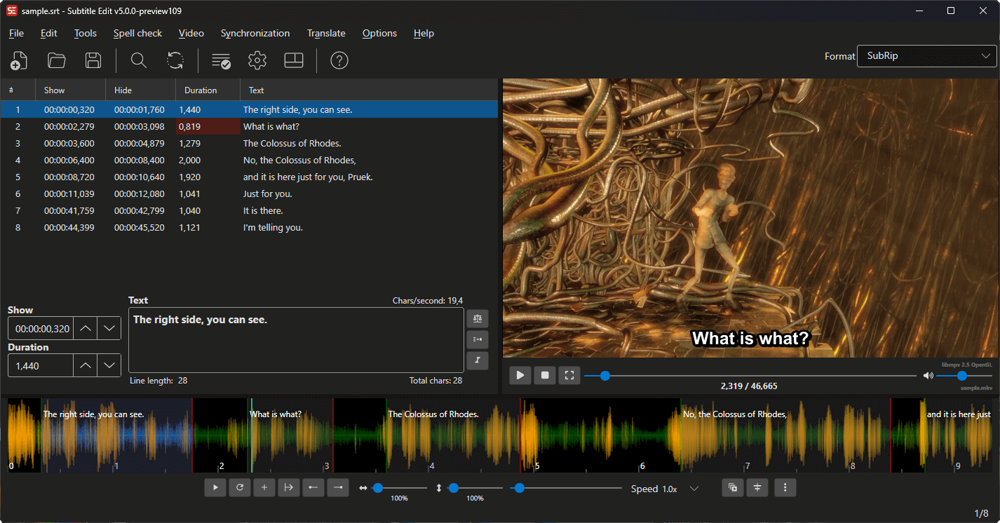
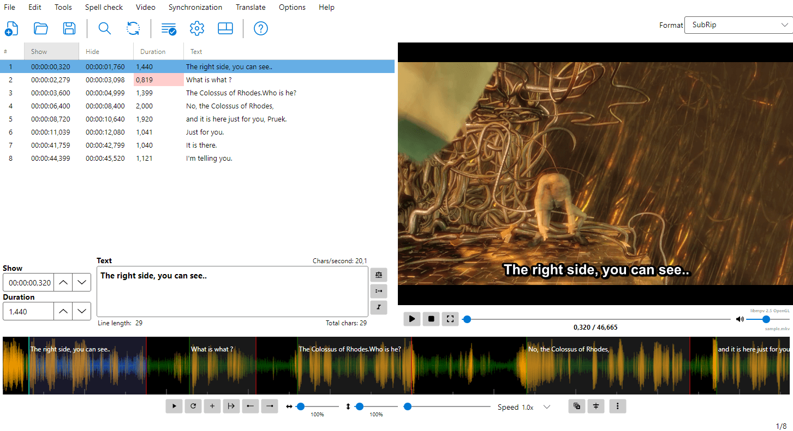

# Overview

## What is Subtitle Edit?

Subtitle Edit is a free, open-source editor for video subtitles. It allows you to create, edit, adjust, and convert subtitles in a wide variety of formats.

**Subtitle Edit 5** is the latest generation, built with [Avalonia UI](https://avaloniaui.net/) for cross-platform support (Windows, Linux, macOS).

## Key Features

- **Create and edit** subtitles in 380+ formats
- **Synchronize** subtitles to video with visual tools
- **Speech to Text** — transcribe audio using Whisper, Qwen3 ASR, Crisp ASR, and other local/cloud engines
- **Text to Speech** — generate audio from subtitle text
- **Translate** subtitles automatically
- **OCR** — convert image-based subtitles (Blu-ray, DVD, etc.) to text
- **Fix common errors** automatically
- **Spell check** with dictionary support
- **Burn-in** subtitles into video
- **Batch convert** multiple files
- **ASSA/SSA styling** with advanced override tags, drawing, and positioning
- **Waveform/spectrogram** for precise timing
- **Shot change detection** for professional workflows
- **Export to image based subtitles** (Blu-ray SUP, BDN-xml, VobSub, etc.)

## System Requirements

- Windows 10 (version 22H2 / build 19045) or newer, Linux, or macOS 12 (Monterey) or newer (macOS 14 / Sonoma or newer recommended - that is the oldest macOS .NET 10 is supported on)
- [FFmpeg](https://ffmpeg.org/) (for audio/video processing, waveforms, burn-in etc.)
- [libmpv](https://mpv.io/) for video playback

How you get FFmpeg and libmpv depends on the platform:
- **Windows** — not included; Subtitle Edit offers to download them the first time they are needed (libmpv when you open a video, FFmpeg for waveforms and other video features). Both can also be downloaded from **Options → Settings**.
- **macOS** — the `.dmg` is self-contained: libmpv and FFmpeg are bundled inside `Subtitle Edit.app`.
- **Linux** — the Flatpak bundles mpv and FFmpeg. The native `.tar.gz` builds use the system libraries, so install libmpv and FFmpeg with your package manager (see the [README](https://github.com/SubtitleEdit/subtitleedit#linux) for the package names per distribution).

All builds are self-contained and do not need a separate .NET installation.

## Getting Started

Follow these simple steps to begin working with subtitles in Subtitle Edit:

1. **Install Subtitle Edit**  
   Download the latest version from the [Releases](https://github.com/SubtitleEdit/subtitleedit/releases) page:
   - **Windows** — `SubtitleEdit-Windows-x64-Setup.exe` (installer), or `SubtitleEdit-Windows-x64.zip` / `SubtitleEdit-Windows-ARM64.zip` (portable - unzip and run `SubtitleEdit.exe`; settings are kept next to the program)
   - **macOS** — `SubtitleEdit-macOS-ARM64.dmg` (Apple Silicon) or `SubtitleEdit-macOS-x64.dmg` (Intel). Open the `.dmg` and drag `Subtitle Edit.app` into `Applications`; it is signed and notarized, so it opens normally
   - **Linux** — `SubtitleEdit-linux-x64.flatpak` (any distribution, install with `flatpak install SubtitleEdit-linux-x64.flatpak`), or the native `SubtitleEdit-Linux-x64.tar.gz` / `SubtitleEdit-Linux-ARM64.tar.gz` builds (need libmpv and FFmpeg from your package manager, see the [README](https://github.com/SubtitleEdit/subtitleedit#linux))

2. **Open a video file**  
   Go to **Video → Open video...** and select your video.  
   This allows you to preview and sync subtitles accurately.

3. **Open, create, or generate a subtitle file**  
   - Open an existing file via **File → Open**  
   - Create a new one via **File → New**  
   - Or generate subtitles automatically using **speech-to-text** (**Video → Speech to text**)

4. **Edit your subtitles**  
   Use the subtitle grid and text editor to:
   - Adjust text  
   - Split or merge lines  
   - Fine-tune timing  

5. **Adjust timing visually**  
   Use the waveform display to precisely sync subtitles with audio.

6. **Save your work**  
   Go to **File → Save** (or press **Ctrl+S**) to save your subtitle file.

<!-- Screenshot: Main window overview -->

## Main Window Layout

The main window consists of several key areas:

- **Menu Bar** — Access all features
- **Toolbar** — Quick access to common actions
- **Subtitle Grid** — List of all subtitle lines with timing and text
- **Text Editor** — Edit the currently selected subtitle text
- **Video Player** — Preview video with subtitles
- **Audio Visualizer** — Waveform/spectrogram for precise timing adjustments

Subtitle Edit offers **15 different layouts** for arranging these areas. Choose one with the **Layout** button on the toolbar or its configurable shortcut.

For a detailed guide to each area, mouse interactions, and keyboard shortcuts, see the **[Main Window](features/main-window.md)** documentation.

<!-- Screenshot: Main window with light mode -->

